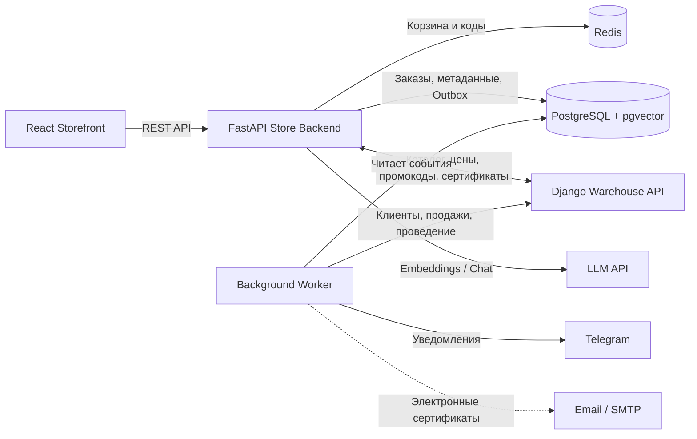
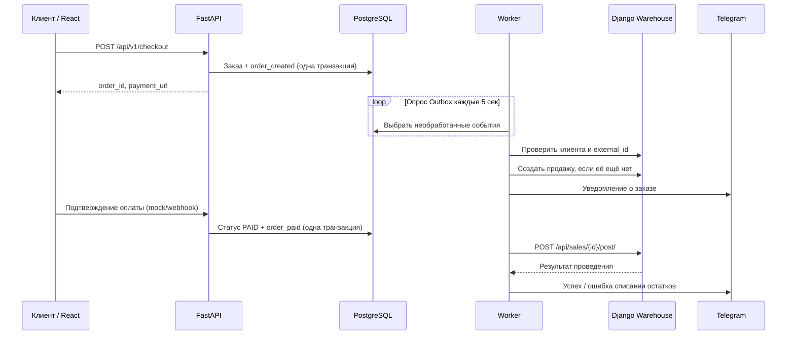

Store Backend
Store Backend — backend интернет-магазина на FastAPI, который связывает клиентскую витрину с системой складского учёта на Django. Сервис отвечает за каталог, корзину, оформление и оплату заказов, клиентскую авторизацию и AI-рекомендации. Обмен событиями со складом вынесен в отдельный воркер с использованием Transactional Outbox.

Это часть системы Warehouse & Store:
- warehouse_project — Django-система складского учёта: товары, остатки, клиенты, продажи и проведение документов.
- store-backend (этот репозиторий) — FastAPI API для магазина, собственная БД, корзина, оформление заказов, интеграции и фоновая обработка событий.
- store-frontend — клиентская витрина на React, которая взаимодействует с FastAPI через REST API.
  Возможности
- Каталог товаров: получение ассортимента и категорий из Django API, объединение складских данных с описаниями, маркетинговыми названиями и фотографиями, хранящимися на стороне магазина; раздел новинок.
- Администрирование витрины: редактирование метаданных и загрузка изображений товаров через защищённые JWT-эндпоинты.
- Корзина на Redis: добавление и удаление товаров, изменение количества, хранение по session_id с TTL, расчёт стоимости.
- Скидки и сертификаты: проверка промокодов и баланса подарочных сертификатов через склад, применение скидок, добавление электронных сертификатов в корзину.
- Оформление заказов: локальная запись заказа и позиций в PostgreSQL, подготовка платежа и публикация бизнес-события через Outbox.
- Синхронизация со складом: создание клиента и продажи через Django REST API, передача состава заказа, промокода и сертификата; проведение оплаченной продажи со списанием остатков.
- Уведомления: сообщения менеджерам в Telegram о новых и оплаченных заказах, предупреждения об ошибках проведения; в коде также предусмотрена email-отправка электронных сертификатов.
- Авторизация: JWT для администратора и клиентов, подтверждение телефона кодом через Redis, получение истории заказов клиента со склада.
- AI-консультант (RAG): индексация каталога в pgvector, семантический поиск по товарам в наличии и генерация рекомендаций через OpenAI-совместимый API.
  Архитектура

Склад — источник данных о товарах, ценах и остатках. FastAPI формирует витрину, дополняя эти данные контентом магазина, и управляет покупательским сценарием. Системы общаются по HTTP с заголовком X-Service-Token для межсервисной авторизации.
  Transactional Outbox и фоновый воркер
Вместо прямого вызова склада из транзакции оформления заказа используется Transactional Outbox:
1. При checkout FastAPI создаёт локальный заказ, его позиции и событие order_created в таблице outbox_events в рамках одной транзакции PostgreSQL.
2. Отдельный процесс worker.py раз в 5 секунд выбирает до 50 необработанных событий со статусом PENDING.
3. Для order_created воркер ищет или создаёт клиента в Django, проверяет наличие продажи по external_id (ID заказа магазина), затем передаёт заказ на склад.
4. После успешной регистрации новой продажи воркер отправляет уведомление менеджерам в Telegram. Если склад вернул сгенерированные сертификаты и указан email клиента, инициируется их отправка.
5. При подтверждении оплаты FastAPI обновляет статус локального заказа и сохраняет отдельное событие order_paid.
6. Обрабатывая order_paid, воркер находит продажу на складе по external_id, вызывает /api/sales/{id}/post/ для проведения продажи и списания остатков, затем формирует Telegram-уведомление об успехе или ошибке.

Обработка ошибок: при части сетевых/неожиданных сбоев событие остаётся необработанным и может быть взято повторно следующим циклом. Некоторые бизнес-ошибки помечаются как ERROR; ошибка проведения продажи фиксируется для ручной проверки. Проверка external_id помогает избежать повторного создания одной продажи. Это не означает гарантированную доставку всех внешних уведомлений или полноценную распределённую очередь.
  Стек технологий
Компонент	Технологии
Backend и API	Python 3.14, FastAPI, Uvicorn, Pydantic
База данных	PostgreSQL 16, SQLAlchemy (async), asyncpg, Alembic
Поиск по векторам	pgvector
Кеш и корзина	Redis (async)
Межсервисное взаимодействие	HTTPX, REST API, сервисный токен
Авторизация	JWT (PyJWT)
AI-рекомендации	OpenAI-совместимый API, embeddings, RAG
Уведомления	Telegram Bot API, aiosmtplib
Контейнеризация	Docker, Docker Compose

🗂 Структура проекта
store-backend/
├── api/                 # REST-эндпоинты: каталог, корзина, оплата, auth, RAG
├── core/                # Настройки, исключения и общие компоненты
├── db/                  # Подключение к PostgreSQL и Redis
├── models/              # SQLAlchemy-модели, включая Order и OutboxEvent
├── schemas/             # Pydantic-схемы запросов и ответов
├── services/            # Бизнес-логика магазина и интеграций
├── migrations/          # Миграции Alembic
├── uploads/             # Загруженные изображения товаров
├── main.py              # FastAPI-приложение и подключение роутеров
├── worker.py            # Фоновая синхронизация и уведомления
├── Dockerfile
├── docker-compose.yaml
└── requirements.txt
  Быстрый запуск
Требования: Docker и Docker Compose; для полноценной синхронизации также нужен доступный экземпляр warehouse_project с настроенным API и тем же сервисным токеном.

1. Клонировать репозиторий:
git clone https://github.com/linkolnn-pixel/store-backend.git
cd store-backend
2. Создать .env в корне проекта:
# PostgreSQL (имя db используется внутри Docker Compose)
POSTGRES_USER=store_user
POSTGRES_PASSWORD=change_me
POSTGRES_DB=store_db
DATABASE_URL=postgresql+asyncpg://store_user:change_me@db:5432/store_db

# Redis
REDIS_URL=redis://redis:6379/0

# Интеграция с Django-складом
WAREHOUSE_URL=http://host.docker.internal:8001
DEFAULT_WAREHOUSE_ID=1
SERVICE_API_KEY=replace_with_shared_service_token

# Авторизация
SECRET_KEY=replace_with_long_random_secret
ADMIN_USERNAME=admin
ADMIN_PASSWORD=replace_with_strong_password

# Telegram
TELEGRAM_BOT_TOKEN=replace_with_bot_token
TELEGRAM_CHAT_ID=replace_with_chat_id

# AI-консультант: OpenAI-совместимый провайдер
LLM_API_KEY=replace_with_llm_api_key
LLM_BASE_URL=https://api.openai.com/v1
EMBEDDING_MODEL=text-embedding-3-small
CHAT_MODEL=gpt-4o-mini
WAREHOUSE_URL — пример для склада, работающего на хосте на порту 8001. Замените адрес и порт на реальные; при запуске в общей Docker-сети используйте имя сервиса склада. Для RAG модель эмбеддингов должна возвращать 1536-мерные векторы, как задано в models/product_embedding.py. Не коммитьте .env с секретами.

3. Запустить сервисы:
docker compose up --build -d
docker compose logs -f store-backend worker
Docker Compose поднимет FastAPI, отдельный воркер, PostgreSQL с pgvector и Redis. Перед запуском API выполняется alembic upgrade head.

4. Проверить API:
- Swagger UI: http://localhost:8000/docs
- OpenAPI: http://localhost:8000/openapi.json
- Health check: http://localhost:8000/health
Для локального запуска без Docker используйте Python 3.14, установите зависимости из requirements.txt, настройте адреса внешних PostgreSQL/Redis в .env, выполните alembic upgrade head, затем запустите uvicorn main:app --reload и отдельно python worker.py.
  Основные API-эндпоинты
Все пути в таблице, кроме /health, начинаются с /api/v1.
Метод	Путь	Назначение
GET	/catalog	Каталог с данными склада и метаданными магазина
GET	/catalog/categories	Категории товаров
GET	/catalog/new_arrivals	Новинки
GET	/catalog/{product_id}	Карточка товара
PATCH	/catalog/{product_id}/meta	Изменение данных товара (админ)
POST	/catalog/{product_id}/image	Загрузка фото (админ)
POST	/cart/add	Добавить товар в корзину
POST	/cart/certificate	Добавить подарочный сертификат
GET	/cart/{session_id}	Получить корзину
POST	/cart/update	Изменить количество
POST	/cart/remove	Удалить товар
POST	/promo/apply	Применить промокод
DELETE	/promo/remove	Удалить промокод
GET	/certificates/validate/	Проверить сертификат
POST	/checkout	Оформить заказ
POST	/webhook	Обработать событие оплаты
GET	/payment/mock-success	Эмулировать успешную оплату
POST	/admin/login	Получить JWT администратора
POST	/customer/request-code	Запросить код подтверждения
POST	/customer/verify-code	Получить JWT клиента
GET	/profile/orders	История заказов клиента
POST	/api/assistant/recommend	RAG-рекомендации товаров
POST	/api/assistant/reindex	Переиндексация каталога (админ)

AI-пути указаны относительно /api/v1, поэтому полный путь рекомендаций — /api/v1/api/assistant/recommend (как он объявлен в текущем main.py и api/rag.py). Полные схемы запросов и ответов доступны в Swagger.

  Как работают AI-рекомендации
Администратор запускает переиндексацию: сервис получает товары из Django, собирает текстовые представления карточек, создаёт embeddings через LLM API и сохраняет их в pgvector. При запросе покупателя выполняется поиск по косинусному расстоянию, учитываются только товары с положительным остатком, а LLM формирует короткий ответ на основе найденного контекста.
  Текущий статус интеграций
- Оплата: в services/payment.py сейчас возвращается mock-ссылка для тестового подтверждения платежа; реальный запрос к YooKassa/эквайрингу не реализован. /payment/mock-success предназначен для разработки, не для production.
- Подтверждение телефона: код записывается в Redis и выводится в лог; реальная SMS-отправка не подключена.
- Email-сертификаты: логика SMTP-отправки присутствует, но перед использованием необходимо добавить SMTP-параметры в конфигурацию core/config.py и окружение.
- Outbox: повторная обработка предусмотрена для части сбоев, однако обработчик требует дополнительного усиления перед production (блокировки при нескольких воркерах, политика повторов, мониторинг и обработка неуспешных уведомлений).
  Связанные проекты
- Warehouse Management System (Django)
